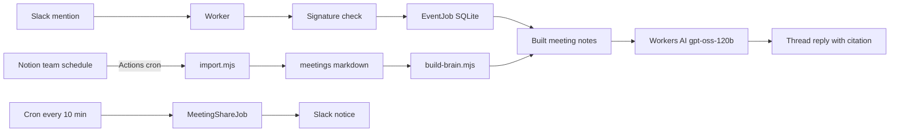

# team-brain

팀 회의록을 Git에 두고, 그 기록만 근거로 Slack 질문에 답하는 저장소입니다. Notion 일정에 올라온 회의록을 GitHub Actions가 가져오고, Cloudflare Worker가 서명 검증 뒤 회의록을 읽어 스레드에 답합니다. 검토 전 기록은 확정된 결정으로 말하지 않습니다.

이 저장소는 그 구현의 **공개 샘플**입니다. `meetings/`와 `sources/`의 네 월 노트는 허구의 짧은 예시이고, 팀 이름은 "북극성"입니다. 사람 이름, 메일, 워크스페이스·채널·사용자 식별자, Notion 페이지·데이터베이스 식별자, Cloudflare 계정 식별자, 토큰은 넣지 않았습니다.

## English

Public sample of a meeting-notes repository. A GitHub Action imports Notion meeting blocks into markdown, and a Cloudflare Worker answers Slack mentions only from those notes, citing the date, status, title, and path. `needs-review` notes are labeled as unreviewed records. The notes here are fictional.

## 구성

| 경로 | 역할 |
| --- | --- |
| `meetings/`, `sources/` | 읽기용 회의록과 전사 예시. 샘플은 허구입니다. |
| `templates/` | 회의록·전사 템플릿 |
| `scripts/check-frontmatter.mjs` | 커밋된 Markdown의 상단 YAML 문법 검사 |
| `scripts/sync.sh`, `scripts/sync.ps1` | 로컬 변경이 있으면 멈추고 `git pull --ff-only`만 실행 |
| `integrations/notion/` | Notion 일정 데이터 소스에서 회의록 블록만 가져와 `needs-review`로 저장 |
| `integrations/slack/` | Slack 멘션에 답하고, 10분마다 회의 공지를 올리는 Worker |
| `AGENTS.md` | 답변 규칙. 배포 시 프롬프트에 포함됩니다. |

## 어떻게 동작하나

1. Slack `app_mention`이 `POST /slack/events`로 들어옵니다. `SLACK_SIGNING_SECRET`으로 서명을 확인하고, 5분을 넘긴 요청은 거절합니다.
2. `SLACK_TEAM_ID`와 `SLACK_CHANNEL_ID`가 모두 맞고, 봇·숨김·수정 이벤트가 아닌 멘션만 `EventJob` Durable Object에 넣습니다. 같은 이벤트는 저장소에 한 번만 들어갑니다.
3. alarm에서 Workers AI `@cf/openai/gpt-oss-120b`가 배포 시 묶인 회의록만 보고 JSON으로 답합니다. 출처 ID가 비어 있으면 초안을 버리고 다음 문장을 반환합니다. `팀 브레인에서 이 질문을 뒷받침할 회의 기록을 찾지 못했습니다.`
4. 인용한 문서 중 `needs-review`가 있으면 답은 `팀원 검토 전 기록을 근거로 한 답변이며, 현재 팀 합의로 확정할 수 없습니다.`로 시작합니다. 출처 줄은 코드가 붙이며, 링크는 이 저장소 `main`의 회의록 파일입니다.
5. 크론 `*/10 * * * *`가 `MeetingShareJob`으로 회의 공지를 보냅니다. `NOTION_DATA_SOURCE_ID`와 일치하는 데이터 소스에서 왔고, `SLACK_MEETING_START_DATE` 이후이며, 공지 채널과 봇 토큰이 있을 때만 전송합니다. 개요 마지막 두 줄과 할 일 처음 두 줄을 우선 발췌하고, 전사 구간은 빼며, 같은 페이지는 `chat.update`로 갱신합니다.
6. Notion 가져오기는 별도 GitHub Actions 일정(`7,17,27,37,47,57 * * * *`)입니다. `팀일정`만 읽고 `개인 일정`은 제외합니다. 요약이 있는 회의록 블록만 저장하며, 상태 속성과 관계없이 `needs-review`로 시작합니다. 이미 Git에서 수정한 파일은 덮어쓰지 않습니다.

답변에 쓸 수 있는 결정 상태는 `confirmed`뿐입니다. `proposed`, `needs-review`, `deferred`, `rejected`, `superseded`는 그 상태로 구분합니다. 규칙 전문은 [AGENTS.md](AGENTS.md)에 있습니다.

## 아키텍처



## 기술 스택

| 구성 | 선택 |
| --- | --- |
| 회의록 | Git의 Markdown과 상단 YAML |
| 가져오기 | GitHub Actions, Notion API `2026-03-11` |
| 런타임 | Cloudflare Workers |
| 상태 | Durable Object SQLite (`EventJob`, `MeetingShareJob`) |
| 모델 | Workers AI `@cf/openai/gpt-oss-120b` |
| 입력 | Slack Events API `app_mention` |
| 스케줄 | Worker 크론 `*/10 * * * *`, Actions 10분 간격 |
| 테스트 | Node.js `node:test` |

## 샘플 회의록

상태는 이 코드가 허용하는 값만 씁니다. `confirmed`는 샘플에서 이미 적힌 결정이고, `needs-review`는 결론이 없는 초안입니다.

- `meetings/2026/04/2026-04-02-kickoff.md` (`confirmed`): 팀 이름 "북극성", 화·목 21:00 스크럼, 당일 회의록 공유.
- `meetings/2026/04/2026-04-09-demo-scope.md` (`needs-review`): 데모 범위를 줄이자는 말과 아직 좁히지 말자는 말이 함께 있고, 결론은 없습니다.
- `meetings/2026/04/2026-04-16-showcase.md` (`confirmed`): 공개 발표 2026-04-30 19:00, 슬라이드는 회의록만 사용.

예시 질문 `팀 이름이 확정됐나요?`는 4월 2일 킥오프를 출처로 답할 수 있습니다. `데모 범위를 줄이자고 했나요?`는 검토 전 초안만 있으므로 확정된 결정으로 말하면 안 됩니다.

## 로컬 확인

Node.js 20 이상이 필요합니다.

```sh
npm ci
npm test
npm run check:yaml -- --all
node --test integrations/notion/test/*.test.mjs
npm ci --prefix integrations/slack
npm test --prefix integrations/slack
```

Slack 워커를 로컬에서 띄울 때는 `integrations/slack`에서 `.dev.vars.example`을 `.dev.vars`로 복사한 뒤 값을 채웁니다. 값이 비어 있으면 질문 채널 검증에 실패해 멘션을 무시합니다. `GET /health`는 `{ "ok": true }`를 반환합니다.

```sh
cd integrations/slack
npm ci
npm test
npx wrangler dev
```

Notion 가져오기 식별자는 `integrations/notion/config.json`의 자리표시자입니다. 실제 데이터 소스 ID로 바꾼 뒤, 환경 변수 `NOTION_TOKEN`만 설정하고 `node integrations/notion/import.mjs --dry-run`으로 확인할 수 있습니다.

## 배포 시 채울 값

Git에는 빈 칸만 둡니다. 설명은 `.env.example`과 `integrations/slack/.dev.vars.example`에 있습니다.

- Slack: `SLACK_SIGNING_SECRET`, `SLACK_BOT_TOKEN`, `SLACK_TEAM_ID`, `SLACK_CHANNEL_ID`, `SLACK_MEETING_CHANNEL_ID`, `SLACK_MEETING_START_DATE`
- 회의 공지 필터: `NOTION_DATA_SOURCE_ID` (Notion 일정 데이터 소스 ID, 하이픈 있어도 됩니다)
- Notion 가져오기: Actions secret `NOTION_TOKEN`, 그리고 `integrations/notion/config.json`의 데이터 소스·데이터베이스 ID

Worker 이름과 계정은 `wrangler login` 이후 배포 환경에서 정합니다. `wrangler.jsonc`에는 계정 ID를 넣지 않습니다.

## 저장소에 없는 것

실제 회의 내용, 구성원 이름과 별명, 메일 주소, Slack 워크스페이스 주소와 팀·채널·사용자 ID, Notion 페이지 주소와 ID, Cloudflare 계정·D1·KV ID, 토큰. 샘플 노트를 실제 기록으로 바꾸지 말고, 비밀은 `.dev.vars`나 Actions secret, `wrangler secret`에만 두세요.
