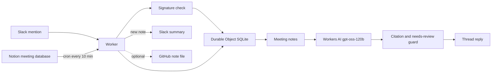

# team-brain

슬랙에서 팀 질문을 받으면, **회의록에 있는 내용만** 날짜와 출처와 함께 답하는 봇입니다. 노션 회의록을 약 10분마다 동기화하고, 새 노트가 생기면 슬랙에 짧은 안내를 올립니다.

이 저장소는 실제 팀에서 돌고 있는 봇의 **공개 샘플**입니다. 회의 원문, 사람 이름, 워크스페이스·채널·사용자 식별자, 노션 페이지 식별자, 클라우드플레어 계정 식별자, 비밀 값은 들어 있지 않습니다. `meetings/`와 `sources/`의 세 편은 짧은 허구의 예시입니다.

## English

Public sample of a Slack bot that answers team questions only from meeting notes, with the date and a source link. A cron trigger syncs a Notion database about every 10 minutes and posts a short notice when a new note arrives. Unreviewed `needs-review` notes are cited as records, not as confirmed decisions. The notes in this repo are fictional.

## 문제

회의에서 정한 내용은 노션과 슬랙에 흩어집니다. 나중에 "그때 뭐로 했지?"를 물으면 기억이나 검색 결과에 의존하게 되고, 아직 검토하지 않은 초안이 확정된 결정처럼 전달되기도 합니다.

team-brain은 답의 범위를 회의록으로 제한합니다. 기록에 없으면 모른다고 말하고, 검토 전 문서는 합의된 사실로 말하지 않습니다.

## 어떻게 동작하나

1. 슬랙 앱 멘션(`app_mention`)이 `POST /slack/events`로 들어옵니다. 서명(`SLACK_SIGNING_SECRET`)이 맞고 5분 안의 요청만 받습니다.
2. Durable Object `TeamBrain`이 이벤트 id를 기억해서 슬랙 재시도를 한 번만 처리합니다.
3. 저장된 회의록 중에서 질문과 겹치는 노트를 고릅니다. 모델이 고르는 것이 아닙니다.
4. Workers AI `@cf/openai/gpt-oss-120b`가 그 노트만 보고 짧은 한국어 답을 만듭니다. 모델이 없거나 실패하면 노트에서 발췌한 문장으로 대신합니다.
5. 코드가 답을 다시 검사합니다. 근거가 없으면 초안을 버리고 거절 문장을 반환합니다. 근거가 모두 `needs-review`이면 확정 표현을 빼고, 검토 전이라는 문장으로 시작합니다. 출처 줄은 모델이 아니라 코드가 붙입니다.
6. 크론 `*/10 * * * *`가 노션 데이터베이스를 읽고 새 노트를 Durable Object에 넣습니다. `GITHUB_TOKEN`이 있으면 같은 마크다운을 이 저장소에 올립니다. `SLACK_SUMMARY_CHANNEL`이 있으면 새 노트를 한 번씩만 알립니다.

노션이 연결되지 않은 로컬·샘플 배포에서는 `meetings/`의 예시 노트를 넣고, 그 예시는 이미 안내된 것으로 표시해 슬랙에 다시 올리지 않습니다.

## 아키텍처



## 기술 스택

| 구성 | 선택 |
| --- | --- |
| 런타임 | Cloudflare Workers |
| 상태 | Durable Object + SQLite (노트, 이벤트 id, 안내 여부) |
| 모델 | Workers AI `@cf/openai/gpt-oss-120b` |
| 입력 | Slack Events API, Notion database API |
| 스케줄 | Cron `*/10 * * * *` |
| 테스트 | Node.js 22 `node:test` |

## 안전 동작

답은 검색된 회의록 밖을 보지 않습니다.

- 검색 결과가 없으면 `회의록에서 이 질문의 근거를 찾지 못했습니다`로 끝냅니다. 모델이 만들어 낸 문장은 사용하지 않습니다.
- `status: reviewed`인 노트만 기록된 결정으로 말합니다. 출처는 `날짜 / reviewed / 제목 / 파일 경로`와 이 저장소의 blob 링크입니다.
- `status: needs-review`만 있으면 답은 이렇게 시작합니다.

  > 팀원 검토 전 기록을 근거로 한 답변이며, 현재 팀 합의로 확정할 수 없습니다.

  `확정되었습니다`, `결정했습니다` 같은 문장은 최종 답에서 제거합니다. 새 노트 안내도 검토 전 초안의 본문을 사실처럼 인용하지 않고, 날짜·제목·상태·링크만 올립니다.
- 검토된 노트와 검토 전 노트가 함께 있으면, 검토 전 출처는 합의가 아니라고 한 줄을 붙입니다.
- 슬랙 서명이 틀리거나 타임스탬프가 5분을 넘으면 `401`입니다.

예시 질문 `팀 이름이 확정됐나요?`는 `meetings/2026/04/2026-04-02-kickoff.md`(reviewed)의 "북극성"을 출처와 함께 답합니다. `데모 범위를 줄이자고 했나요?`는 `needs-review` 초안만 찾으므로 확정된 결정으로 말하지 않습니다.

## 회의록 형식

```markdown
---
date: 2026-04-02
title: 킥오프
status: reviewed
source_url: https://notes.example/sample/kickoff
transcript: sources/meetings/2026/04/2026-04-02-kickoff.md
---

본문
```

`status`가 없거나 `reviewed`가 아니면 `needs-review`로 둡니다. 노션에서는 제목, 날짜, 상태(status 또는 select) 속성을 읽습니다. 날짜가 없는 페이지는 건너뜁니다.

## 로컬 실행

```bash
npm install
cp .dev.vars.example .dev.vars
npm test
npm run dev
```

`.dev.vars`에 비밀을 채우기 전에는 슬랙 엔드포인트가 500을 반환합니다. `GET /health`는 설정 없이 `{ "ok": true, "service": "team-brain" }`를 반환합니다.

슬랙 앱의 Event Subscriptions 요청 URL은 `https://<worker-host>/slack/events` 입니다. 구독 이벤트는 `app_mention`이면 됩니다.

## 테스트

```bash
npm test
npm run check
```

테스트는 예시 회의록, 서명 검증, 재시도 중복 제거, `needs-review` 안전장치, 노션 페이지 변환, 10분 크론이 적힌 Wrangler 설정을 확인합니다. 외부 슬랙·노션·클라우드플레어는 호출하지 않습니다.

## 배포

계정 식별자는 저장소에 넣지 않습니다. `wrangler login` 이후 비밀만 등록합니다.

```bash
wrangler secret put SLACK_SIGNING_SECRET
wrangler secret put SLACK_BOT_TOKEN
wrangler secret put SLACK_BOT_USER_ID
wrangler secret put SLACK_SUMMARY_CHANNEL
wrangler secret put NOTION_TOKEN
wrangler secret put NOTION_DATABASE_ID
# 선택: 동기화한 노트를 git 파일로도 남길 때
wrangler secret put GITHUB_TOKEN
wrangler secret put GITHUB_REPO
npm run deploy
```

변수 설명은 `.env.example`에 있습니다. `NOTES_REPO_URL`만 `wrangler.jsonc`의 공개 값으로 두고, 나머지 비밀은 `wrangler secret`으로 넣습니다.

## 저장소에 없는 것

실제 팀의 회의 내용, 구성원 이름, 메일 주소, 슬랙 워크스페이스 주소, 노션 페이지 주소, 클라우드플레어·D1·KV 식별자, 토큰. 예시 노트를 실제 기록으로 바꾸지 말고, 비밀은 `.dev.vars`나 Wrangler secret에만 두세요. 자세한 작업 경계는 `AGENTS.md`에 있습니다.
